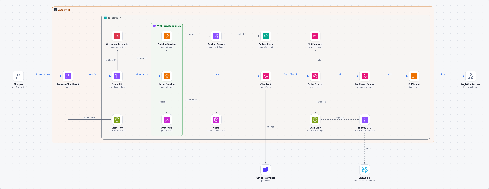

# blueprint-md

**Architecture as code, for people and coding agents.**

Describe a system in one small YAML file, or let your AI agent design it with you. blueprint-md turns that file into a clean architecture diagram with real logos, plus an `ARCHITECTURE.md` that tells a coding agent exactly what each component does and what it may talk to.

<picture>
  <source media="(prefers-color-scheme: dark)" srcset="examples/ecommerce-on-aws/architecture-dark.png">
  
</picture>

## Why

Diagrams drawn by hand go stale, and pictures mean nothing to a coding agent. blueprint-md keeps one text file as the source of truth:

```
architecture.yaml  ──build──▶  architecture.html / .png   for people
                         └──▶  ARCHITECTURE.md            for coding agents
```

- **Readable and diff-able:** the architecture lives in git next to the code.
- **Meaningful connections:** every line says what flows, over which protocol, with which payload.
- **Decisions included:** context, choice, alternatives and consequences are part of the file and the document.
- **Agent-ready:** hand `ARCHITECTURE.md` to Claude Code, Cursor or Codex as the plan for building the project.

## What it looks like

```yaml
title: Online Store on AWS

groups:
  aws:    {label: AWS Cloud, icon: aws:AWS-Cloud-logo, color: orange}
  region: {label: eu-central-1, icon: aws:Region, parent: aws}
  vpc:    {label: VPC · private subnets, icon: aws:Amazon-Virtual-Private-Cloud, color: green, parent: region}

components:
  orders:
    type: aws/fargate                   # building block from the catalog
    name: Order Service                 # project-specific name
    group: vpc
    at: [4.2, 1.5]
    code: services/orders
    about: Owns orders and stock. Reserves stock and starts the checkout workflow.
  checkout:
    type: aws/step-functions
    name: Checkout
    group: region
    at: [7, 1.5]
  bus:
    type: aws/eventbridge
    name: Order Events
    group: region
    at: [8.4, 1.5]
  stripe:
    type: stripe/payments               # catalogs cover SaaS too
    at: [7, 4.3]

connections:
  - orders -> checkout: start
    primary: true
  - checkout -> stripe: charge
    protocol: REST, idempotency key
  - checkout ..> bus: OrderPlaced       # dashed = async
    primary: true

decisions:
  - title: EventBridge as the backbone after checkout
    status: accepted
    alternatives: [SNS fan-out (no content-based routing), Direct calls (couples checkout to every consumer)]
```

See the full example in [`examples/ecommerce-on-aws/`](examples/ecommerce-on-aws/): the [YAML](examples/ecommerce-on-aws/architecture.yaml), the [generated ARCHITECTURE.md](examples/ecommerce-on-aws/ARCHITECTURE.md) and the [interactive HTML](examples/ecommerce-on-aws/architecture.html). The full format is in [`skills/blueprint-md/references/format.md`](skills/blueprint-md/references/format.md).

More examples:

- [`examples/order-to-cash/`](examples/order-to-cash/): Salesforce orders to SAP S/4HANA through MuleSoft API-led layers
- [`examples/salesforce-to-aws/`](examples/salesforce-to-aws/): Salesforce events processed on AWS

## Building block catalog

The catalog lists the parts you can use, so people and agents share one vocabulary. Each entry says what the block is, when to use it, when not to, and links to the official documentation:

```bash
python3 skills/blueprint-md/scripts/blueprint.py catalog            # list everything
python3 skills/blueprint-md/scripts/blueprint.py catalog event      # search
```

- **Browse it:** [`skills/blueprint-md/catalog/README.md`](skills/blueprint-md/catalog/README.md)
- **Included (230 blocks):**
  - **Clouds:** AWS, Microsoft Azure and Google Cloud (compute, storage, databases, integration, networking, security, analytics and AI)
  - **Salesforce and MuleSoft:** clouds, Flow, Apex, Platform Events, Change Data Capture, Pub/Sub API, Named Credentials, API-led layers…
  - **Data platforms:** Snowflake, Databricks, Confluent/Kafka, dbt, Fivetran, Airbyte, Airflow, Power BI
  - **Enterprise SaaS:** SAP, Microsoft 365, Dynamics 365 and Power Platform, ServiceNow, Workday, Oracle, HubSpot, Zendesk, Jira
  - **Developer and web platforms:** Kubernetes, Docker, Vercel, Cloudflare, Supabase, GitHub, Stripe, Twilio, MongoDB, Datadog, the Claude and OpenAI APIs…
  - **Identity:** Okta, Auth0, Ping, Keycloak, Vault, plus SAML, OIDC, OAuth and SCIM
  - **Generic:** user, service, database, queue, scheduler…
- **Use it:** `type: salesforce/platform-event` on a component fills in name, role and icon, and ARCHITECTURE.md adds the description, docs link and what the block is not meant for
- **Extend it:** add `catalog/<domain>.yaml` to the skill, or `catalogs: [my-blocks.yaml]` to one project
- **Keep it current:** entries hold only stable facts and link to the official docs for details that change. Each entry has a `checked: YYYY-MM` date. `blueprint.py catalog --check` validates every entry, flags entries not reviewed for six months, and opens every docs link in a headless browser. A GitHub Action runs it every month and whenever the catalog changes.

## Official vendor icons

AWS, Azure, Google Cloud and Salesforce components use the vendors' **official icons**, not community copies:

| Vendor | Package | Write |
|---|---|---|
| AWS | [AWS Architecture Icons](https://aws.amazon.com/architecture/icons/) | `icon: aws:lambda` |
| Microsoft Azure | [Azure architecture icons](https://learn.microsoft.com/azure/architecture/icons/) | `icon: azure:function apps` |
| Google Cloud | [Google Cloud icons](https://cloud.google.com/icons) | `icon: gcp:bigquery` |
| Salesforce | [Lightning Design System icons](https://www.lightningdesignsystem.com/icons/) (standard set) | `icon: slds:data_cloud` |

Each package is downloaded once from the vendor's site into `~/.cache/blueprint-md/packs/` (the newest AWS and Azure release is found automatically) and indexed by name. Search it with `blueprint.py icons aws lambda`; refresh it with `--update`. Salesforce icons come from the `@salesforce-ux/icons` npm package: each white glyph is used unchanged on the background colour the Design System defines for it, the way Salesforce shows them. Icons are only embedded into the diagrams you build and are never stored in this repo. Each vendor's terms apply to its icons; the Salesforce icons are © Salesforce, licensed [CC BY-ND 4.0](https://creativecommons.org/licenses/by-nd/4.0/).

## Use it with an AI agent

The repo contains two [agent skills](https://agentskills.io) that work as a pair:

| Skill | Phase | What it does |
|---|---|---|
| **blueprint-architect** | think | Acts as a senior architect: turns business requirements and constraints (licensed tools, platforms, budget, skills) into numbered requirements, drafts 2–4 real solution options, checks each against every requirement, recommends one and lets you decide. Writes `architecture-options.md`. |
| **blueprint-md** | draw | Turns the chosen option into `architecture.yaml`, the diagram and `ARCHITECTURE.md`; the rejected options become decision records. |

Install both for Claude Code:

```bash
git clone https://github.com/Sav019/blueprint-md.git
mkdir -p ~/.claude/skills
ln -s "$(pwd)/blueprint-md/skills/blueprint-architect" ~/.claude/skills/blueprint-architect
ln -s "$(pwd)/blueprint-md/skills/blueprint-md" ~/.claude/skills/blueprint-md
```

Start from requirements:

> /blueprint-architect Our service agents need answers from PDF and HTML manuals stored in Google Cloud Storage. We have Data 360 and Agentforce, no new vendors. Some manuals are HR-only.

The agent lists the requirements and constraints, asks what is still open, compares the options and recommends one. After you choose, it draws the result with blueprint-md.

Or go straight to the drawing:

> Let's design the architecture for syncing orders from Salesforce to SAP. Ask me what you need to know.

The agent asks about volumes, timing, data ownership and authentication, proposes options with trade-offs, records your decisions, and writes and builds the YAML. Ask it to "just draw it" and it decides on its own and marks its choices as proposed decisions for you to review.

## Use it from the command line

```bash
pip install pyyaml                      # required
pip install playwright && python3 -m playwright install chromium   # only for PNGs

python3 skills/blueprint-md/scripts/blueprint.py build architecture.yaml --png
python3 skills/blueprint-md/scripts/blueprint.py check architecture.yaml
```

`build` writes `architecture.html`, `ARCHITECTURE.md` and, with `--png`, light and dark PNGs. `check` validates the file and reports layout problems such as overlapping groups, lines crossing components, or labels without room. Icons are fetched on first use from svgl, devicon, gilbarbara/logos and Lucide, and cached in `.blueprint/` next to the YAML.

## Roadmap

- [x] Building block catalog with docs links and automatic link checks
- [x] Catalogs for AWS, Azure and Google Cloud with the official icon sets
- [x] More catalogs: data platforms, enterprise SaaS, developer platforms, identity
- [ ] Project scaffolding from the YAML (starting with Salesforce SFDX projects)
- [ ] Mermaid and C4 export
- [x] Official Salesforce icons (Lightning Design System, `slds:`)
- [ ] Salesforce product logos for each cloud (Sales, Service, Marketing, Commerce)
- [ ] Several views (overview and detail) from one model
- [ ] Interactive canvas for editing with an agent

## License

MIT. Brand logos fetched at build time remain the trademarks of their owners.
