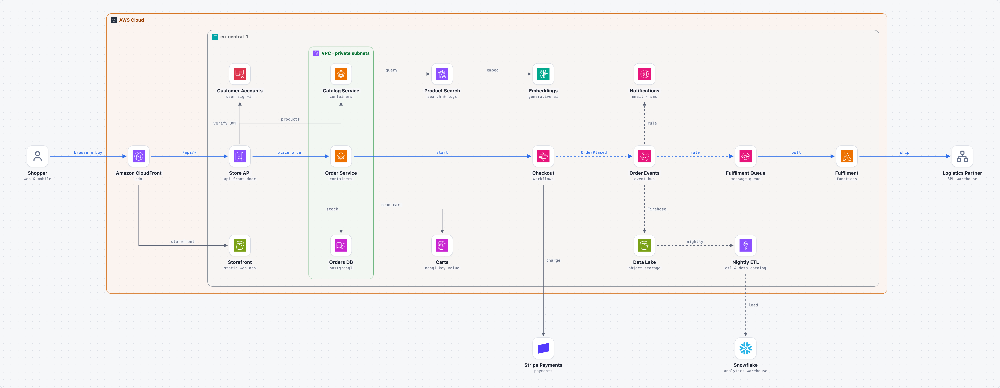

# Online Store on AWS

Shoppers browse and buy through CloudFront and API Gateway. Containerised catalog and order services run on Fargate; checkout is a Step Functions workflow that charges the card with Stripe and publishes OrderPlaced to EventBridge. Fulfilment, notifications and analytics react to that event independently, and product search uses OpenSearch with Bedrock embeddings.

> Generated by blueprint-md from `architecture.yaml`. Edit the YAML and rebuild instead of editing this file.

## At a glance

- 21 components, 3 groups, 20 connections, 3 flows, 1 walkthrough, 5 decisions

## Structure

- **AWS Cloud**
  - **Amazon CloudFront** (`cdn`): cdn
  - **eu-central-1**: Single region with three Availability Zones; all stateful services are Multi-AZ.
    - **Customer Accounts** (`auth`): user sign-in
    - **Product Search** (`search`): search & logs
    - **Embeddings** (`ai`): generative ai
    - **Notifications** (`notify`): email · sms
    - **Store API** (`api`): api front door
    - **Checkout** (`checkout`): workflows
    - **Order Events** (`bus`): event bus
    - **Fulfilment Queue** (`queue`): message queue
    - **Fulfilment** (`fulfil`): functions
    - **Storefront** (`assets`): static web app
    - **Carts** (`carts`): nosql key-value
    - **Data Lake** (`lake`): object storage
    - **Nightly ETL** (`etl`): etl & data catalog
    - **VPC · private subnets**: Services and the database have no public IPs; outbound traffic leaves through NAT gateways.
      - **Catalog Service** (`catalog`): containers
      - **Order Service** (`orders`): containers
      - **Orders DB** (`db`): postgresql
- **Shopper** (`shopper`): web & mobile (outside all groups)
- **Stripe Payments** (`stripe`): payments (outside all groups)
- **Snowflake** (`warehouse`): analytics warehouse (outside all groups)
- **Logistics Partner** (`logistics`): 3PL warehouse (outside all groups)

## Components

### Amazon CloudFront (`cdn`)

Single entry point. Serves the storefront from S3 and routes /api/* to API Gateway; AWS WAF is attached here.

- **Building block:** [Amazon CloudFront](https://aws.amazon.com/cloudfront/) (`aws/cloudfront`): Global content delivery network for static files, websites and APIs.
- **Role:** cdn
- **Part of:** AWS Cloud
- **Sends to:**
  - **Storefront** (`assets`): storefront, origin access control
  - **Store API** (`api`): /api/*
- **Receives from:**
  - **Shopper** (`shopper`): browse & buy, HTTPS

### Customer Accounts (`auth`)

Shopper sign-up, sign-in and social login. Issues the JWTs that API Gateway checks.

- **Building block:** [Amazon Cognito](https://aws.amazon.com/cognito/) (`aws/cognito`): Sign-up, sign-in and tokens for web and mobile app users, including social and SAML login.
- **Role:** user sign-in
- **Part of:** AWS Cloud › eu-central-1
- **Not meant for:** Employee single sign-on that already runs through a corporate identity provider.
- **Receives from:**
  - **Store API** (`api`): verify JWT

### Product Search (`search`)

Hybrid keyword and vector search over the catalog.

- **Building block:** [Amazon OpenSearch Service](https://aws.amazon.com/opensearch-service/) (`aws/opensearch`): Managed OpenSearch for full-text search, log analytics and vector search.
- **Role:** search & logs
- **Technology:** OpenSearch Serverless, vector + keyword index
- **Part of:** AWS Cloud › eu-central-1
- **Not meant for:** As the primary system of record.
- **Sends to:**
  - **Embeddings** (`ai`): embed, ML connector
- **Receives from:**
  - **Catalog Service** (`catalog`): query

### Embeddings (`ai`)

Turns product texts and shopper queries into vectors through the OpenSearch ML connector.

- **Building block:** [Amazon Bedrock](https://aws.amazon.com/bedrock/) (`aws/bedrock`): Managed access to foundation models from several providers, plus agents, knowledge bases and guardrails.
- **Role:** generative ai
- **Technology:** Titan Text Embeddings
- **Part of:** AWS Cloud › eu-central-1
- **Receives from:**
  - **Product Search** (`search`): embed, ML connector

### Notifications (`notify`)

Order confirmation and shipping updates to the shopper.

- **Building block:** [Amazon SNS](https://aws.amazon.com/sns/) (`aws/sns`): Publishes messages to many subscribers at once, including queues, functions, email and SMS.
- **Role:** email · sms
- **Part of:** AWS Cloud › eu-central-1
- **Not meant for:** Content-based routing between many event types (EventBridge is more flexible).
- **Receives from:**
  - **Order Events** (`bus`): rule (async / batch)

### Store API (`api`)

Public REST API for the storefront. Validates tokens, throttles per client and forwards to the services over a VPC link.

- **Building block:** [Amazon API Gateway](https://aws.amazon.com/api-gateway/) (`aws/api-gateway`): Publishes, secures and throttles REST, HTTP and WebSocket APIs in front of Lambda or other backends.
- **Role:** api front door
- **Technology:** HTTP API, JWT authorizer, VPC link
- **Part of:** AWS Cloud › eu-central-1
- **Not meant for:** Internal service-to-service calls inside one VPC (a load balancer is enough).
- **Sends to:**
  - **Customer Accounts** (`auth`): verify JWT
  - **Catalog Service** (`catalog`): products
  - **Order Service** (`orders`): place order, VPC link
- **Receives from:**
  - **Amazon CloudFront** (`cdn`): /api/*

### Checkout (`checkout`)

Express workflow - charge card, confirm stock, publish OrderPlaced; on payment failure it releases the reserved stock.

- **Building block:** [AWS Step Functions](https://aws.amazon.com/step-functions/) (`aws/step-functions`): Visual state machines that coordinate Lambda functions and AWS services with retries and error handling.
- **Role:** workflows
- **Part of:** AWS Cloud › eu-central-1
- **Code:** `workflows/checkout`
- **Not meant for:** A single function call with no orchestration.
- **Sends to:**
  - **Stripe Payments** (`stripe`): charge, REST, idempotency key
  - **Order Events** (`bus`): OrderPlaced (async / batch)
- **Receives from:**
  - **Order Service** (`orders`): start, orderId, amount

### Order Events (`bus`)

Carries OrderPlaced, OrderShipped and OrderCancelled to every consumer through rules.

- **Building block:** [Amazon EventBridge](https://aws.amazon.com/eventbridge/) (`aws/eventbridge`): Serverless event bus that routes events by rules, including events from SaaS partners such as Salesforce.
- **Role:** event bus
- **Technology:** custom event bus, schema registry
- **Part of:** AWS Cloud › eu-central-1
- **Not meant for:** High-throughput ordered streams (use Kinesis).
- **Sends to:**
  - **Fulfilment Queue** (`queue`): rule (async / batch)
  - **Notifications** (`notify`): rule (async / batch)
  - **Data Lake** (`lake`): Firehose (async / batch)
- **Receives from:**
  - **Checkout** (`checkout`): OrderPlaced (async / batch)

### Fulfilment Queue (`queue`)

Buffers orders for fulfilment, with a dead-letter queue for orders the partner rejects.

- **Building block:** [Amazon SQS](https://aws.amazon.com/sqs/) (`aws/sqs`): Fully managed message queue that decouples producers from consumers.
- **Role:** message queue
- **Part of:** AWS Cloud › eu-central-1
- **Not meant for:** Several consumers need the same message (use SNS or EventBridge to fan out).
- **Sends to:**
  - **Fulfilment** (`fulfil`): poll
- **Receives from:**
  - **Order Events** (`bus`): rule (async / batch)

### Fulfilment (`fulfil`)

Sends each order to the logistics partner and publishes OrderShipped with the tracking number.

- **Building block:** [AWS Lambda](https://aws.amazon.com/lambda/) (`aws/lambda`): Runs code in response to events or requests without managing servers; billed per invocation.
- **Role:** functions
- **Part of:** AWS Cloud › eu-central-1
- **Code:** `functions/fulfilment`
- **Not meant for:** Long-running jobs or steady high load (containers are simpler and cheaper there).
- **Sends to:**
  - **Logistics Partner** (`logistics`): ship, REST, OAuth 2.0
- **Receives from:**
  - **Fulfilment Queue** (`queue`): poll

### Storefront (`assets`)

Built Next.js storefront (static export) and product images; only CloudFront can read it (origin access control).

- **Building block:** [Amazon S3](https://aws.amazon.com/s3/) (`aws/s3`): Durable object storage for files, backups, data lakes and static websites.
- **Role:** static web app
- **Part of:** AWS Cloud › eu-central-1
- **Code:** `apps/storefront`
- **Not meant for:** Data that needs queries, transactions or frequent small updates (use a database).
- **Receives from:**
  - **Amazon CloudFront** (`cdn`): storefront, origin access control

### Carts (`carts`)

Shopping carts keyed by session, with a TTL so abandoned carts expire on their own.

- **Building block:** [Amazon DynamoDB](https://aws.amazon.com/dynamodb/) (`aws/dynamodb`): Serverless key-value and document database with consistent single-digit-millisecond access.
- **Role:** nosql key-value
- **Part of:** AWS Cloud › eu-central-1
- **Not meant for:** Ad-hoc queries, reporting or many-to-many relations (use a relational database).
- **Receives from:**
  - **Order Service** (`orders`): read cart

### Data Lake (`lake`)

Every order event, archived as Parquet by Amazon Data Firehose.

- **Building block:** [Amazon S3](https://aws.amazon.com/s3/) (`aws/s3`): Durable object storage for files, backups, data lakes and static websites.
- **Role:** object storage
- **Technology:** Firehose → Parquet, partitioned by day
- **Part of:** AWS Cloud › eu-central-1
- **Not meant for:** Data that needs queries, transactions or frequent small updates (use a database).
- **Sends to:**
  - **Nightly ETL** (`etl`): nightly (async / batch)
- **Receives from:**
  - **Order Events** (`bus`): Firehose (async / batch)

### Nightly ETL (`etl`)

Cleans and joins the day's events and loads them into Snowflake.

- **Building block:** [AWS Glue](https://aws.amazon.com/glue/) (`aws/glue`): Serverless data integration (ETL) and a central catalog of data sets.
- **Role:** etl & data catalog
- **Part of:** AWS Cloud › eu-central-1
- **Sends to:**
  - **Snowflake** (`warehouse`): load, Snowpipe (async / batch)
- **Receives from:**
  - **Data Lake** (`lake`): nightly (async / batch)

### Catalog Service (`catalog`)

Product details, prices and search. Keeps the OpenSearch index in sync with the product data.

- **Building block:** [AWS Fargate](https://aws.amazon.com/fargate/) (`aws/fargate`): Runs ECS or EKS containers without managing the underlying servers.
- **Role:** containers
- **Technology:** TypeScript, ECS on Fargate
- **Part of:** AWS Cloud › eu-central-1 › VPC · private subnets
- **Code:** `services/catalog`
- **Not meant for:** Workloads that need GPUs or host-level access.
- **Sends to:**
  - **Product Search** (`search`): query
- **Receives from:**
  - **Store API** (`api`): products

### Order Service (`orders`)

Owns orders and stock. Reads the cart, reserves stock in one transaction and starts the checkout workflow.

- **Building block:** [AWS Fargate](https://aws.amazon.com/fargate/) (`aws/fargate`): Runs ECS or EKS containers without managing the underlying servers.
- **Role:** containers
- **Technology:** TypeScript, ECS on Fargate
- **Part of:** AWS Cloud › eu-central-1 › VPC · private subnets
- **Code:** `services/orders`
- **Not meant for:** Workloads that need GPUs or host-level access.
- **Sends to:**
  - **Orders DB** (`db`): stock, SQL, TLS
  - **Carts** (`carts`): read cart
  - **Checkout** (`checkout`): start, orderId, amount
- **Receives from:**
  - **Store API** (`api`): place order, VPC link

### Orders DB (`db`)

Aurora PostgreSQL (Serverless v2, Multi-AZ) for orders, order lines and stock levels.

- **Building block:** [Amazon Aurora](https://aws.amazon.com/rds/aurora/) (`aws/aurora`): MySQL- and PostgreSQL-compatible database built for the cloud, including a serverless option.
- **Role:** postgresql
- **Part of:** AWS Cloud › eu-central-1 › VPC · private subnets
- **Not meant for:** Small, steady databases where standard RDS is cheaper.
- **Receives from:**
  - **Order Service** (`orders`): stock, SQL, TLS

### Shopper (`shopper`)

Browses products, searches in natural language and checks out.

- **Building block:** User (`generic/user`): A person who uses the system.
- **Role:** web & mobile
- **Sends to:**
  - **Amazon CloudFront** (`cdn`): browse & buy, HTTPS

### Stripe Payments (`stripe`)

Card and wallet payments. The Payment Intent is created and confirmed by the checkout workflow.

- **Building block:** [Stripe Payments](https://docs.stripe.com/payments) (`stripe/payments`): Accepts card and local payment methods, subscriptions and invoices through an API and hosted pages.
- **Role:** payments
- **Not meant for:** Payment flows tied to a provider your company or region already requires.
- **Receives from:**
  - **Checkout** (`checkout`): charge, REST, idempotency key

### Snowflake (`warehouse`)

Sales, conversion and stock reporting for the business, shared with Finance.

- **Building block:** [Snowflake Virtual Warehouse](https://docs.snowflake.com/en/user-guide/warehouses) (`snowflake/warehouse`): A compute cluster that runs queries and loads; scales and suspends independently of storage.
- **Role:** analytics warehouse
- **Not meant for:** Always-on sizing for spiky use; let it auto-suspend instead.
- **Receives from:**
  - **Nightly ETL** (`etl`): load, Snowpipe (async / batch)

### Logistics Partner (`logistics`)

Third-party warehouse that picks, packs and ships. Exposes a REST API and sends tracking updates.

- **Building block:** External System (`generic/external-system`): A system outside your control that you integrate with.
- **Role:** 3PL warehouse
- **Receives from:**
  - **Fulfilment** (`fulfil`): ship, REST, OAuth 2.0

## Connections

| # | From | To | What | Style | Details |
|---|---|---|---|---|---|
| 1 | Shopper | Amazon CloudFront | browse & buy | main flow, one-way | HTTPS |
| 2 | Amazon CloudFront | Storefront | storefront | one-way | origin access control |
| 3 | Amazon CloudFront | Store API | /api/* | main flow, one-way |  |
| 4 | Store API | Customer Accounts | verify JWT | one-way |  |
| 5 | Store API | Catalog Service | products | one-way |  |
| 6 | Store API | Order Service | place order | main flow, one-way | VPC link |
| 7 | Catalog Service | Product Search | query | one-way |  |
| 8 | Product Search | Embeddings | embed | one-way | ML connector |
| 9 | Order Service | Orders DB | stock | one-way | SQL, TLS |
| 10 | Order Service | Carts | read cart | one-way |  |
| 11 | Order Service | Checkout | start | main flow, one-way | orderId, amount |
| 12 | Checkout | Stripe Payments | charge | one-way | REST, idempotency key |
| 13 | Checkout | Order Events | OrderPlaced | main flow, async / batch |  |
| 14 | Order Events | Fulfilment Queue | rule | main flow, async / batch |  |
| 15 | Fulfilment Queue | Fulfilment | poll | main flow, one-way |  |
| 16 | Fulfilment | Logistics Partner | ship | main flow, one-way | REST, OAuth 2.0 |
| 17 | Order Events | Notifications | rule | async / batch |  |
| 18 | Order Events | Data Lake | Firehose | async / batch |  |
| 19 | Data Lake | Nightly ETL | nightly | async / batch |  |
| 20 | Nightly ETL | Snowflake | load | async / batch | Snowpipe |

## Flows

### Shopper places an order

1. Shopper → Amazon CloudFront: browse & buy
2. Amazon CloudFront → Store API: /api/*
3. Store API → Order Service: place order
4. Order Service → Checkout: start
5. Checkout → Order Events: OrderPlaced
6. Order Events → Fulfilment Queue: rule
7. Fulfilment Queue → Fulfilment: poll
8. Fulfilment → Logistics Partner: ship

### Shopper searches "warm jacket for hiking"

1. Shopper → Amazon CloudFront: browse & buy
2. Amazon CloudFront → Store API: /api/*
3. Store API → Catalog Service: products
4. Catalog Service → Product Search: query
5. Product Search → Embeddings: embed

### Nightly sales reporting

1. Order Events → Data Lake: Firehose
2. Data Lake → Nightly ETL: nightly
3. Nightly ETL → Snowflake: load

## Walkthroughs

Step-by-step scenarios; `walkthrough.html` plays them on the diagram.

### Shopper places an order

From the Buy button to the parcel leaving the warehouse. The API call ends after checkout publishes OrderPlaced; everything after that reacts to the event on its own.

1. **Click "Buy now"** (Shopper → Amazon CloudFront; HTTPS POST /api/orders): The storefront sends the order with the shopper's JWT. AWS WAF on CloudFront filters bots and abuse.
2. **Route /api/* to the Store API** (Amazon CloudFront → Store API): CloudFront forwards API paths to API Gateway; static files never reach it.
3. **Verify the shopper** (Store API → Customer Accounts; JWT authorizer): API Gateway checks the Cognito token and throttles per client before any service runs.
4. **Place the order** (Store API → Order Service; VPC link): The request enters the private subnets; the Order Service owns orders and stock.
5. **Read the cart** (Order Service → Carts): The cart is loaded from DynamoDB by session id.
6. **Reserve stock** (Order Service → Orders DB; SQL transaction): Order, order lines and the stock reservation are written in one Aurora transaction.
7. **Start checkout** (Order Service → Checkout; StartSyncExecution (orderId, amount)): An Express workflow takes over payment, stock confirmation and publishing.
8. **Charge the card** (Checkout → Stripe Payments; REST, idempotency key = orderId): Stripe confirms the Payment Intent. If the payment fails, the workflow's compensation path releases the reserved stock and the shopper sees the error.
9. **Publish OrderPlaced** (Checkout → Order Events; EventBridge PutEvents): One event for every consumer; the API returns the order number to the shopper now.
10. **Send the confirmation** (Order Events → Notifications; rule → SNS): The shopper gets the order confirmation by email or SMS.
11. **Archive the event** (Order Events → Data Lake; rule → Firehose): Every order event lands in S3 as Parquet for the nightly reporting.
12. **Queue for fulfilment** (Order Events → Fulfilment Queue; rule → SQS): The queue absorbs peaks; orders the partner rejects go to a dead-letter queue.
13. **Pick up the order** (Fulfilment Queue → Fulfilment): The Fulfilment function polls the queue in batches. Handlers are idempotent because events can arrive twice.
14. **Ship it** (Fulfilment → Logistics Partner; REST, OAuth 2.0): The 3PL picks and packs; the function publishes OrderShipped with the tracking number.

## Decisions

### D1. EventBridge as the backbone after checkout (accepted)

- **Context:** Fulfilment, notifications and analytics all react to a placed order, and more consumers will follow.
- **Decision:** Checkout publishes one OrderPlaced event; each consumer gets its own EventBridge rule.
- **Alternatives considered:**
  - SNS fan-out (no content-based routing or schema registry)
  - Direct calls from checkout (couples checkout to every consumer)
- **Consequences:** New consumers need no change to checkout. Consumers must be idempotent, because events can arrive twice.

### D2. Step Functions for checkout instead of code in the order service (accepted)

- **Context:** Checkout spans payment, stock and events, and must undo the stock reservation when payment fails.
- **Decision:** An Express workflow orchestrates the steps with retries and a compensation path.
- **Alternatives considered:**
  - Saga inside the order service (harder to see and retry)
  - Choreography with events only (no single view of a checkout)
- **Consequences:** Every checkout is visible step by step in the console; workflow definitions live in workflows/.

### D3. Aurora for orders, DynamoDB for carts (accepted)

- **Context:** Orders need transactions across order lines and stock; carts are high-volume, short-lived key-value data.
- **Decision:** Orders and stock in Aurora PostgreSQL; carts in DynamoDB with TTL.
- **Consequences:** Two data stores to operate, but each fits its access pattern and carts never load the orders database.

### D4. Fargate for services, Lambda for event handlers (accepted)

- **Decision:** Long-running APIs with steady traffic run as containers; short event-driven steps run as functions.
- **Alternatives considered:**
  - Everything on Lambda (cold starts on the API
  - connection pooling to Aurora)
  - Everything on EKS (cluster to operate)
- **Consequences:** Two deployment styles, both defined in one CDK app.

### D5. Semantic product search with Bedrock embeddings (proposed)

- **Context:** Shoppers describe what they need ("warm jacket for hiking") rather than typing product names.
- **Decision:** Hybrid keyword and vector search in OpenSearch Serverless; embeddings from Bedrock through the ML connector.
- **Alternatives considered:**
  - Keyword search only (misses intent)
  - Algolia (another vendor and data copy)
- **Consequences:** Embedding costs per product update and per query; the index must be rebuilt when the embedding model changes.

## Notes for coding agents

- Infrastructure as code: one AWS CDK app in infra/, one stack per group (edge, services, data, events).
- Repo layout: apps/storefront, services/<name>, functions/<name>, workflows/<name>.
- Secrets (Stripe key, logistics client secret) live in AWS Secrets Manager; never in environment files.
- Every event carries orderId and a correlationId; log both in every service.

- Component ids (in backticks) are stable names: reuse them for modules, services, folders and config keys.
- A component should only talk to the components listed in its **Sends to**, **Receives from**, **Two-way with** and **Linked with** entries. If the code needs a new connection, add it to the YAML first.
- Decisions above are binding unless the user changes them.
