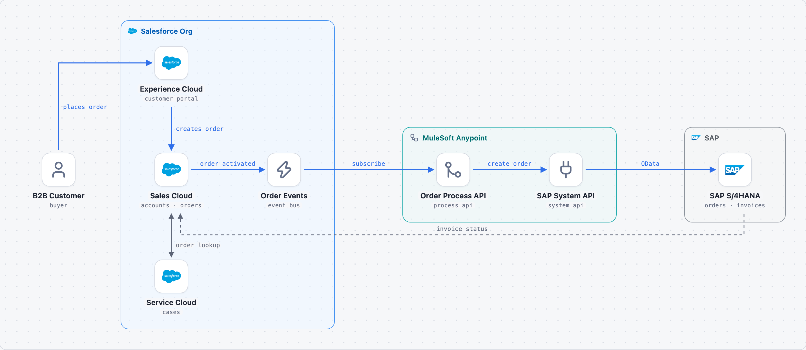

# Order-to-Cash

Customers order in an Experience Cloud portal. Activated orders leave Salesforce as Platform Events, MuleSoft turns them into SAP sales orders, and invoice status flows back every hour.

> Generated by blueprint-md from `architecture.yaml`. Edit the YAML and rebuild instead of editing this file.

## At a glance

- 8 components, 3 groups, 8 connections, 1 flow, 2 decisions

## Structure

- **Salesforce Org**: Single production org, Sales and Service Cloud licenses.
  - **Experience Cloud** (`portal`): customer portal
  - **Sales Cloud** (`sales`): accounts · orders
  - **Order Events** (`events`): event bus
  - **Service Cloud** (`service`): cases
- **MuleSoft Anypoint**: API-led connectivity, CloudHub 2.0.
  - **Order Process API** (`process`): process api
  - **SAP System API** (`system`): system api
- **SAP**
  - **SAP S/4HANA** (`erp`): orders · invoices
- **B2B Customer** (`customer`): buyer (outside all groups)

## Components

### Experience Cloud (`portal`)

Self-service portal where customers browse prices and place orders.

- **Building block:** [Experience Cloud](https://help.salesforce.com/s/articleView?id=experience.networks_overview.htm&type=5) (`salesforce/experience-cloud`): Portals, partner sites and customer self-service sites built on the org's data and security model.
- **Role:** customer portal
- **Part of:** Salesforce Org
- **Not meant for:** High-traffic public marketing sites or storefronts (use a CMS or Commerce Cloud).
- **Sends to:**
  - **Sales Cloud** (`sales`): creates order
- **Receives from:**
  - **B2B Customer** (`customer`): places order

### Sales Cloud (`sales`)

System of record for accounts, contracts and orders. Owns the Order object.

- **Building block:** [Sales Cloud](https://www.salesforce.com/sales/) (`salesforce/sales-cloud`): CRM for accounts, contacts, leads, opportunities, quotes and orders.
- **Role:** accounts · orders
- **Part of:** Salesforce Org
- **Code:** `force-app/main/default/objects/Order`
- **Not meant for:** Complex pricing, billing or fulfilment usually stays in an ERP or a dedicated revenue product.
- **Sends to:**
  - **Order Events** (`events`): order activated. Record-triggered flow publishes Order_Sync__e.
- **Receives from:**
  - **Experience Cloud** (`portal`): creates order
  - **SAP S/4HANA** (`erp`): invoice status (async / batch). Hourly batch through MuleSoft updates Invoice__c records on the order.
- **Two-way with:**
  - **Service Cloud** (`service`): order lookup

### Order Events (`events`)

Published by a record-triggered flow when an order is activated.

- **Building block:** [Platform Event](https://developer.salesforce.com/docs/platform/platform-events/guide/platform-events-intro.html) (`salesforce/platform-event`): Publish/subscribe messages inside Salesforce and to external subscribers, with replay for a limited time.
- **Role:** event bus
- **Technology:** Order_Sync__e (high-volume platform event)
- **Part of:** Salesforce Org
- **Not meant for:** Request-reply calls that need an immediate answer, or bulk data loads.
- **Sends to:**
  - **Order Process API** (`process`): subscribe, Pub/Sub API (gRPC), Order_Sync__e
- **Receives from:**
  - **Sales Cloud** (`sales`): order activated. Record-triggered flow publishes Order_Sync__e.

### Service Cloud (`service`)

Handles order complaints; agents see order and invoice status on the case.

- **Building block:** [Service Cloud](https://www.salesforce.com/service/) (`salesforce/service-cloud`): Case management, omni-channel routing, knowledge and contact-center tooling for support teams.
- **Role:** cases
- **Part of:** Salesforce Org
- **Not meant for:** Pure field work scheduling (use Field Service on top of it).
- **Two-way with:**
  - **Sales Cloud** (`sales`): order lookup

### Order Process API (`process`)

Maps Salesforce orders to SAP sales orders, handles retries and idempotency.

- **Building block:** [Process API](https://docs.mulesoft.com/general/api-led-overview) (`mulesoft/process-api`): API-led layer that orchestrates business processes across systems and maps data between them.
- **Role:** process api
- **Part of:** MuleSoft Anypoint
- **Not meant for:** Direct system access (that belongs in a system API).
- **Sends to:**
  - **SAP System API** (`system`): create order, HTTPS / REST
- **Receives from:**
  - **Order Events** (`events`): subscribe, Pub/Sub API (gRPC), Order_Sync__e

### SAP System API (`system`)

Thin wrapper over SAP OData services; the only component allowed to call SAP.

- **Building block:** [System API](https://docs.mulesoft.com/general/api-led-overview) (`mulesoft/system-api`): API-led layer that exposes one backend system (ERP, database, Salesforce) through a stable interface.
- **Role:** system api
- **Part of:** MuleSoft Anypoint
- **Not meant for:** Putting cross-system business logic inside it.
- **Sends to:**
  - **SAP S/4HANA** (`erp`): OData, OData v4, OAuth 2.0, A_SalesOrder
- **Receives from:**
  - **Order Process API** (`process`): create order, HTTPS / REST

### SAP S/4HANA (`erp`)

System of record for pricing, fulfilment and invoicing.

- **Role:** orders · invoices
- **Part of:** SAP
- **Sends to:**
  - **Sales Cloud** (`sales`): invoice status (async / batch). Hourly batch through MuleSoft updates Invoice__c records on the order.
- **Receives from:**
  - **SAP System API** (`system`): OData, OData v4, OAuth 2.0, A_SalesOrder

### B2B Customer (`customer`)

Purchasing agent at a customer account.

- **Building block:** User (`generic/user`): A person who uses the system.
- **Role:** buyer
- **Sends to:**
  - **Experience Cloud** (`portal`): places order

## Connections

| # | From | To | What | Style | Details |
|---|---|---|---|---|---|
| 1 | B2B Customer | Experience Cloud | places order | main flow, one-way |  |
| 2 | Experience Cloud | Sales Cloud | creates order | main flow, one-way |  |
| 3 | Sales Cloud | Order Events | order activated | main flow, one-way | Record-triggered flow publishes Order_Sync__e. |
| 4 | Order Events | Order Process API | subscribe | main flow, one-way | Pub/Sub API (gRPC); Order_Sync__e |
| 5 | Order Process API | SAP System API | create order | main flow, one-way | HTTPS / REST |
| 6 | SAP System API | SAP S/4HANA | OData | main flow, one-way | OData v4, OAuth 2.0; A_SalesOrder |
| 7 | SAP S/4HANA | Sales Cloud | invoice status | async / batch | Hourly batch through MuleSoft updates Invoice__c records on the order. |
| 8 | Service Cloud | Sales Cloud | order lookup | two-way |  |

## Flows

### Order placed online

1. B2B Customer → Experience Cloud: places order
2. Experience Cloud → Sales Cloud: creates order
3. Sales Cloud → Order Events: order activated
4. Order Events → Order Process API: subscribe
5. Order Process API → SAP System API: create order
6. SAP System API → SAP S/4HANA: OData

## Decisions

### D1. Platform Events instead of polling (accepted)

- **Context:** About 5,000 orders a day; SAP must see new orders within a minute.
- **Decision:** Publish Order_Sync__e on activation and let MuleSoft subscribe through the Pub/Sub API.
- **Alternatives considered:**
  - Scheduled polling from MuleSoft (burns API limits, adds latency)
  - Outbound messages (no replay, limited payload control)
- **Consequences:** Events are retained for 72 hours, so MuleSoft can replay after an outage.

### D2. API-led layers in MuleSoft (accepted)

- **Decision:** A process API holds the mapping logic; only the system API talks to SAP.
- **Why:** SAP changes stay behind one API, and other channels can reuse the process API later.

## Notes for coding agents

Salesforce metadata lives in an SFDX project (force-app/). MuleSoft apps live in mule/.
Use Named Credentials for every outbound call from Salesforce.

- Component ids (in backticks) are stable names: reuse them for modules, services, folders and config keys.
- A component should only talk to the components listed in its **Sends to**, **Receives from**, **Two-way with** and **Linked with** entries. If the code needs a new connection, add it to the YAML first.
- Decisions above are binding unless the user changes them.
