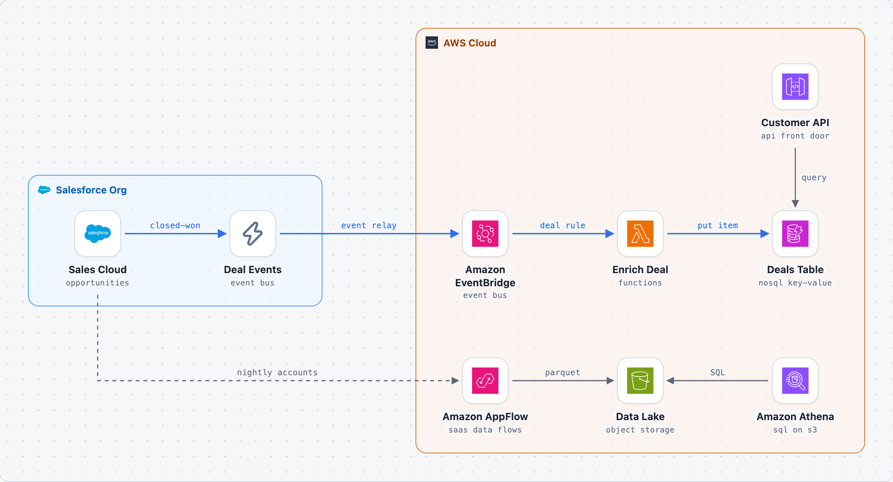

# Salesforce events on AWS

Opportunity changes leave Salesforce as Platform Events and arrive in Amazon EventBridge. A Lambda function enriches them into DynamoDB for a customer API, and AppFlow copies account data to S3 every night for analytics in Athena.

> Generated by blueprint-md from `architecture.yaml`. Edit the YAML and rebuild instead of editing this file.

## At a glance

- 9 components, 2 groups, 8 connections, 1 flow, 1 decision

## Structure

- **Salesforce Org**
  - **Sales Cloud** (`sales`): opportunities
  - **Deal Events** (`events`): event bus
- **AWS Cloud**
  - **Customer API** (`api`): api front door
  - **Amazon EventBridge** (`bus`): event bus
  - **Enrich Deal** (`enrich`): functions
  - **Deals Table** (`table`): nosql key-value
  - **Amazon AppFlow** (`flow`): saas data flows
  - **Data Lake** (`lake`): object storage
  - **Amazon Athena** (`query`): sql on s3

## Components

### Sales Cloud (`sales`)

Sales reps update opportunities; closed-won deals must reach the customer API within seconds.

- **Building block:** [Sales Cloud](https://www.salesforce.com/sales/) (`salesforce/sales-cloud`): CRM for accounts, contacts, leads, opportunities, quotes and orders.
- **Role:** opportunities
- **Part of:** Salesforce Org
- **Not meant for:** Complex pricing, billing or fulfilment usually stays in an ERP or a dedicated revenue product.
- **Sends to:**
  - **Deal Events** (`events`): closed-won
  - **Amazon AppFlow** (`flow`): nightly accounts (async / batch)

### Deal Events (`events`)

Published by a record-triggered flow when an opportunity is closed-won.

- **Building block:** [Platform Event](https://developer.salesforce.com/docs/platform/platform-events/guide/platform-events-intro.html) (`salesforce/platform-event`): Publish/subscribe messages inside Salesforce and to external subscribers, with replay for a limited time.
- **Role:** event bus
- **Technology:** Deal_Closed__e
- **Part of:** Salesforce Org
- **Not meant for:** Request-reply calls that need an immediate answer, or bulk data loads.
- **Sends to:**
  - **Amazon EventBridge** (`bus`): event relay
- **Receives from:**
  - **Sales Cloud** (`sales`): closed-won

### Customer API (`api`)

Read-only API for the customer portal, backed by the deals table.

- **Building block:** [Amazon API Gateway](https://aws.amazon.com/api-gateway/) (`aws/api-gateway`): Publishes, secures and throttles REST, HTTP and WebSocket APIs in front of Lambda or other backends.
- **Role:** api front door
- **Part of:** AWS Cloud
- **Not meant for:** Internal service-to-service calls inside one VPC (a load balancer is enough).
- **Sends to:**
  - **Deals Table** (`table`): query

### Amazon EventBridge (`bus`)

Receives Salesforce events through the partner event source and routes deal events by rule.

- **Building block:** [Amazon EventBridge](https://aws.amazon.com/eventbridge/) (`aws/eventbridge`): Serverless event bus that routes events by rules, including events from SaaS partners such as Salesforce.
- **Role:** event bus
- **Part of:** AWS Cloud
- **Not meant for:** High-throughput ordered streams (use Kinesis).
- **Sends to:**
  - **Enrich Deal** (`enrich`): deal rule
- **Receives from:**
  - **Deal Events** (`events`): event relay

### Enrich Deal (`enrich`)

Adds product and region data and writes one item per deal.

- **Building block:** [AWS Lambda](https://aws.amazon.com/lambda/) (`aws/lambda`): Runs code in response to events or requests without managing servers; billed per invocation.
- **Role:** functions
- **Part of:** AWS Cloud
- **Code:** `services/enrich-deal`
- **Not meant for:** Long-running jobs or steady high load (containers are simpler and cheaper there).
- **Sends to:**
  - **Deals Table** (`table`): put item
- **Receives from:**
  - **Amazon EventBridge** (`bus`): deal rule

### Deals Table (`table`)

- **Building block:** [Amazon DynamoDB](https://aws.amazon.com/dynamodb/) (`aws/dynamodb`): Serverless key-value and document database with consistent single-digit-millisecond access.
- **Role:** nosql key-value
- **Part of:** AWS Cloud
- **Not meant for:** Ad-hoc queries, reporting or many-to-many relations (use a relational database).
- **Receives from:**
  - **Enrich Deal** (`enrich`): put item
  - **Customer API** (`api`): query

### Amazon AppFlow (`flow`)

Nightly full export of accounts to S3.

- **Building block:** [Amazon AppFlow](https://aws.amazon.com/appflow/) (`aws/appflow`): No-code data flows between SaaS apps such as Salesforce and AWS services like S3 and Redshift.
- **Role:** saas data flows
- **Part of:** AWS Cloud
- **Not meant for:** Complex transformations or orchestration across many systems (use middleware or Step Functions).
- **Sends to:**
  - **Data Lake** (`lake`): parquet
- **Receives from:**
  - **Sales Cloud** (`sales`): nightly accounts (async / batch)

### Data Lake (`lake`)

- **Building block:** [Amazon S3](https://aws.amazon.com/s3/) (`aws/s3`): Durable object storage for files, backups, data lakes and static websites.
- **Role:** object storage
- **Part of:** AWS Cloud
- **Not meant for:** Data that needs queries, transactions or frequent small updates (use a database).
- **Receives from:**
  - **Amazon AppFlow** (`flow`): parquet
  - **Amazon Athena** (`query`): SQL

### Amazon Athena (`query`)

- **Building block:** [Amazon Athena](https://aws.amazon.com/athena/) (`aws/athena`): Serverless SQL queries directly on data stored in S3.
- **Role:** sql on s3
- **Part of:** AWS Cloud
- **Sends to:**
  - **Data Lake** (`lake`): SQL

## Connections

| # | From | To | What | Style | Details |
|---|---|---|---|---|---|
| 1 | Sales Cloud | Deal Events | closed-won | main flow, one-way |  |
| 2 | Deal Events | Amazon EventBridge | event relay | main flow, one-way |  |
| 3 | Amazon EventBridge | Enrich Deal | deal rule | main flow, one-way |  |
| 4 | Enrich Deal | Deals Table | put item | main flow, one-way |  |
| 5 | Customer API | Deals Table | query | one-way |  |
| 6 | Sales Cloud | Amazon AppFlow | nightly accounts | async / batch |  |
| 7 | Amazon AppFlow | Data Lake | parquet | one-way |  |
| 8 | Amazon Athena | Data Lake | SQL | one-way |  |

## Flows

### Deal closed

1. Sales Cloud → Deal Events: closed-won
2. Deal Events → Amazon EventBridge: event relay
3. Amazon EventBridge → Enrich Deal: deal rule
4. Enrich Deal → Deals Table: put item

## Decisions

### D1. EventBridge partner integration instead of a custom subscriber (proposed)

- **Decision:** Use Salesforce's event relay to Amazon EventBridge rather than running a Pub/Sub API client.
- **Why:** No client to host or keep connected; routing rules live in AWS.

## Notes for coding agents

- Component ids (in backticks) are stable names: reuse them for modules, services, folders and config keys.
- A component should only talk to the components listed in its **Sends to**, **Receives from**, **Two-way with** and **Linked with** entries. If the code needs a new connection, add it to the YAML first.
- Decisions above are binding unless the user changes them.
